# Full End-to-End (E2E) Testing Architecture, Build System & Developer Verification Guide

## 1. Executive Summary & Philosophy

Maraekat is not a generic CRUD application. It is a branch- and counter-aware foreign-exchange, regulatory compliance, multi-currency financial operations, and inventory platform. Every transaction, transfer, master data edit, or voucher participates in an integrated business chain:

```text
Organization & Master Setup
  ──▶ Reference & Financial Profiles
        ──▶ Party & Product Profiles
              ──▶ Purchase / Sale / Remittance / Transfer
                    ──▶ Tax (GST/TCS/CDF), Postings & Stock Ledgers
                          ──▶ Reports, Audit, Day End/Start (BOD/EOD) & Period Locks
```

A change in any subsystem—whether a new API endpoint, database column, validation rule, or UI form—ripples through double-entry accounting postings, physical counter cash drawers, tax ledgers, and RBI statutory reporting.

### 🫵 Mandatory Developer Mandate
> [!IMPORTANT]
> **Every developer working on this codebase MUST strictly follow these rules:**
> 1. **Zero Uncovered Code:** Every new feature, endpoint, or business validation must be covered with **both positive and negative automated E2E test cases**.
> 2. **Field-Level Completeness:** Test cases must assert every mandatory and optional header, item, passenger, and payment field against valid and invalid inputs.
> 3. **Ledger & Report Verification:** Verify that transactions generate proper double-entry accounting postings and update inventory reports without leaking drafts into trial balances.
> 4. **Mandatory Local E2E Execution:** Developers **must run the full 35-suite E2E test suite locally (`pnpm test:e2e`)** before submitting any Pull Request. A PR will be rejected if any suite fails.

---

## 2. Build Architecture & Technical Standards

### 2.1 Backend Build (`NestJS + TypeORM + PostgreSQL`)

- **Build Command:**
  ```bash
  cd backend
  pnpm build
  ```
  Runs `nest build`, invoking the TypeScript compiler (`tsc`) with configuration in [backend/tsconfig.build.json](file:///Users/sarthakshah/Desktop/projects/maraekat/backend/tsconfig.build.json), outputting compiled JavaScript and declarations to `backend/dist/`.

- **Dual Database Connections:**
  - **DB1 (`AppDataSource`):** Defined in `backend/src/database/data-source.ts`. Manages organizational masters, products, currencies, accounts, party profiles, users, and permissions. Migrations live in `backend/src/migrations/`.
  - **DB2 (`AppDataSource2`):** Defined in `backend/src/database/data-source2.ts`. Manages high-throughput operational entities: `transactions`, `transfers`, `vouchers`, `day_end_start_process`, and `monthly_locks`. Migrations live in `backend/src/migrations2/`.
  - **Hard Cross-DB Rule:** Never create TypeORM relations or foreign-key constraints across DB1 and DB2. Reference parent IDs as plain UUIDs and store immutable reference snapshots (`branchSnapshot`, `partyProfileSnapshot`, etc.).

- **PostgreSQL Column Types (Strict Rule):**
  - **`citext`:** Case-insensitive text. **MUST** be used for all codes, identifiers, names, labels, and values requiring case-insensitive comparison or uniqueness (e.g. `branch_code`, `currency_code`, `pan`, `passport_number`).
  - **`text`:** Used for free-form content, JSON strings, tokens, hashes, and opaque keys.
  - **`varchar` / `character varying`:** **FORBIDDEN** for any new or modified column.

- **TypeORM Migrations (Strict Rule):**
  - **Never hand-write migration files.**
  - Always generate migrations through TypeORM CLI using positional syntax:
    ```bash
    cd backend
    pnpm run migration:generate <migration-name>
    ```
  - Apply migrations:
    ```bash
    pnpm run migration:run
    ```

### 2.2 Frontend Build (`Vite + React 19 + Tailwind CSS`)

- **Build Command:**
  ```bash
  cd frontend
  pnpm build
  ```
  Runs `tsc -b && vite build`, compiling TypeScript with zero type errors and bundling assets with Rolldown/Vite.

- **Component & Form Reuse Standards:**
  - **Shared Form Controls:** All forms must use shared components (`Form`, `FormFieldInput`, `FormFieldSelect`, `FormFieldDatePicker`, `FormFieldCheckbox`, and existing table field arrays).
  - **No Raw HTML Controls:** Never introduce raw `<input>`, `<select>`, or ad-hoc table selectors in feature forms.
  - **Async Selects:** Async dropdowns must provide static options through `defaultOptions` and supply `isLoading` directly from the query hook.
  - **Date Display:** All user-facing transaction dates must be formatted as `dd/mm/yyyy`. Machine-readable ISO format is strictly restricted to API and DB storage.
  - **Pagination (Hard Limit):** Backend APIs enforce `MAX_PAGINATION_LIMIT = 100`. The frontend must never pass `limit > 100`. For large masters, use infinite scrolling or offset pagination.

### 2.3 E2E Test Suite Build & Execution

- **Test Runner Config:** Configured in [backend/test/jest-e2e.json](file:///Users/sarthakshah/Desktop/projects/maraekat/backend/test/jest-e2e.json).
- **TypeScript Integration:** Uses `ts-jest` to compile `.e2e-spec.ts` files on the fly targeting ES2020 with `experimentalDecorators: true` and `strictNullChecks: false`.
- **Single-Worker Execution (`maxWorkers: 1` / `--runInBand`):**
  Because E2E tests validate physical counter drawers, cash balances, sequential voucher numbering, and trial balances across real transactions, **all test suites must execute sequentially in a single thread**. Parallel execution would cause database deadlocks and balance collisions.

---

## 3. The 35 E2E Test Suites Catalog

The test suite consists of 35 comprehensive suites located in [backend/test/e2e/suites/](file:///Users/sarthakshah/Desktop/projects/maraekat/backend/test/e2e/suites/).

```mermaid
flowchart TD
    subgraph P1["Phase 1: Baseline & Master Setup"]
        S01["01-baseline-reports"]
        S02["02-bod-eod-locks"]
        S03["03-party-profiles"]
    end

    subgraph P2["Phase 2: Product Lifecycles"]
        S04["04-products-cc-lifecycle"]
        S05["05-products-cm-lifecycle"]
        S06["06-products-cn-lifecycle"]
        S07["07-products-tt-lifecycle"]
        S08["08-products-tp-lifecycle"]
        S27["27-product-settlements-lifecycle"]
    end

    subgraph P3["Phase 3: Transactions, Stock & Transfers"]
        S09["09-passenger-rules"]
        S10["10-payment-methods"]
        S11["11-ad1-remittance"]
        S12["12-stock-transfers"]
        S18["18-stock-revaluation"]
        S23["23-dashboard-fake-currency"]
        S26["26-card-stock-transfers"]
    end

    subgraph P4["Phase 4: Banking, Advances & Vouchers"]
        S13["13-financial-vouchers"]
        S14["14-advance-adjustment"]
        S15["15-credit-request-fund"]
        S16["16-bank-reconciliation"]
        S17["17-chequebooks-manual-books"]
        S25["25-advance-refunds"]
        S28["28-credit-limits-enforcement"]
        S31["31-cheque-bounce-reconciliation"]
    end

    subgraph P5["Phase 5: Compliance, Tax & Security"]
        S19["19-revisions-and-rollbacks"]
        S20["20-rbi-statutory-reports"]
        S21["21-rbac-isolation"]
        S22["22-print-verifications"]
        S24["24-purchase-rules-fema"]
        S29["29-gst-rule32-charges"]
        S30["30-deal-matching-commission"]
        S32["32-eod-closure-period-locks"]
        S33["33-user-security-lockouts"]
    end

    subgraph P6["Phase 6: Final Accounting Closure"]
        S34["34-final-accounts-profit-merge"]
        S35["35-post-op-reconciliation"]
    end

    P1 --> P2 --> P3 --> P4 --> P5 --> P6
```



### Complete Test Suites Reference Table

| # | Suite File | Operational Domain | Positive Scenarios Covered | Negative / Validation Scenarios Covered |
|:---|:---|:---|:---|:---|
| **01** | `01-baseline-reports` | Financial Baseline | Captures initial state of stock, cash, bank, and trial balance | Asserts baseline metrics are non-null and valid |
| **02** | `02-bod-eod-locks` | Business Date & Locks | Day Start (BOD), Day End (EOD), transition to open | Block transactions before BOD, block transactions after EOD |
| **03** | `03-party-profiles` | Party Master | Create Corporate, FFMC, Card Issuer profiles; approve workflow | Reject unapproved profile usage; reject missing KYC documents |
| **04** | `04-products-cc-lifecycle` | Single Card (CC) | Stock upload, kit mapping, card sale, card reload, settle | Reject unmapped card kit; reject sale without card kit |
| **05** | `05-products-cm-lifecycle` | Multi Card (CM) | Multi-pocket currency load, settlement against issuer | Reject unsupported currency pockets; reject duplicate card kit |
| **06** | `06-products-cn-lifecycle` | Currency Notes (CN) | Retail purchase, retail sale, wholesale FFMC purchase | **Reject sale exceeding counter stock; reject sale with 0 stock** |
| **07** | `07-products-tt-lifecycle` | Remittance (TT) | Outward remittance booking, deal cover rate, settle | Reject invalid beneficiary account; reject invalid SWIFT/BIC |
| **08** | `08-products-tp-lifecycle` | Travellers Cheque (TP) | Cheque stock draw, retail encashment surrender | Reject encashment exceeding counter physical stock |
| **09** | `09-passenger-rules` | Passenger Compliance | Valid PAN, Passport, Third-Party Payer (Paid By PAN) | Tour passenger manifest quantity mismatch rejection |
| **10** | `10-payment-methods` | Payment Methods | Split payments across Cash, Bank, Cheque, UPI, NEFT | Payment sum mismatch with total payable; invalid cheque bank |
| **11** | `11-ad1-remittance` | AD1 Remittance | LRS purpose codes, Form A2 validation, TCS application | Reject invalid purpose code; reject LRS limit breach |
| **12** | `12-stock-transfers` | Stock Transfers | Inter-branch & inter-counter transfers, accept hold | **Reject transfer exceeding stock; reject same source/dest counter** |
| **13** | `13-financial-vouchers` | Vouchers & Postings | Cash/Bank Receipt, Payment, Journal voucher postings | Cash voucher with cheque fields; non-cash mode in cash voucher |
| **14** | `14-advance-adjustment` | Advance Adjustment | Booking advance, adjusting advance against sale | Adjusting more than available advance; advance on wrong party |
| **15** | `15-credit-request-fund` | Credit Facilities | Fund credit request, workplace scoping, approve credit | Unauthorized user approving credit; workplace cross-access |
| **16** | `16-bank-reconciliation` | Bank Reconciliation | Import statement lines, match entries, balance update | Matching reconciled entries twice; unreconciled diff assertion |
| **17** | `17-chequebooks-manual-books` | Cheque & Bill Books | Allocate chequebook leaves, sequential leaf tracking | Issuing leaf already used; issuing from unallocated book |
| **18** | `18-stock-revaluation` | Stock Revaluation | Mark foreign currency to market rate; post P&L delta | Revaluing non-existent currency; unauthorized revaluation |
| **19** | `19-revisions-and-rollbacks` | Revisions & Audits | Amending drafts, approving revision, audit log tracking | Mutating approved transaction without revision; invalid rollback |
| **20** | `20-rbi-statutory-reports` | RBI Compliance | Export FLM-1, FLM-2, FLM-3, and R-Return records | Verifies non-approved drafts are excluded from statutory files |
| **21** | `21-rbac-isolation` | RBAC & Multi-Tenant | Branch/counter context isolation; role permission gates | Cross-branch data reading; unauthorized mutation rejection |
| **22** | `22-print-verifications` | Print Documents | HTML layout validation, company header, tax summary | Missing print template; corrupted voucher financial totals |
| **23** | `23-dashboard-fake-currency` | Fake Currency | Impound counterfeit currency; audit reason tracking | Impounding counterfeit notes exceeding counter stock |
| **24** | `24-purchase-rules-fema` | FEMA Statutory Rules | Compliant Indian purchase (< 1000 USD), NRI cash (< 3000 USD)| Indian cash >= 1000 USD; NRI cheque; Corporate cash |
| **25** | `25-advance-refunds` | Advance Refunds | Refunding unused client advances, bank voucher payout | Refunding already adjusted advance; refund exceeding balance |
| **26** | `26-card-stock-transfers` | Card Kit Transfers | Transferring card kit inventory between branch vaults | Transferring kit already sold or assigned to another counter |
| **27** | `27-product-settlements-lifecycle` | Settlements | Settlement of card/remittance batches with issuer bank | Settling already settled batches; settling mismatching amounts |
| **28** | `28-credit-limits-enforcement` | Credit Limits | Full payment transaction without credit facility | Blocking transaction exceeding approved corporate credit limit |
| **29** | `29-gst-rule32-charges` | GST Rule 32(2)(b) | Value of service calculation, CGST/SGST/IGST tax splits | Additional charges calculation; incorrect state tax splits |
| **30** | `30-deal-matching-commission` | Deal Matching | Forward deal matching, marketing executive commission | Mismatched deal rates; commission exceeding margin |
| **31** | `31-cheque-bounce-reconciliation` | Cheque Bounce | Marking cheque bounced, reverse posting, restore balance | Bouncing already reconciled cheque; duplicate bounce processing |
| **32** | `32-eod-closure-period-locks` | EOD Period Lock | Enforce Day End checklist completion | Reject mutations dated in closed/locked business date |
| **33** | `33-user-security-lockouts` | Security & Sessions | Tracking failed logins, account lockout on brute-force | Locked user denied access; session hijacking prevention |
| **34** | `34-final-accounts-profit-merge` | Final Accounts | Merging net P&L balance into balance sheet equity | Merging without accounting period closing |
| **35** | `35-post-op-reconciliation` | Accounting Closure | **Final Mathematical Closure:** Reports = Baseline + Deltas | Asserts zero leakage from drafts/rejections; Debits = Credits |

---

## 4. Field-by-Field Testing Specification

When testing any API endpoint in Maraekat, developers must validate every single field across request headers, passenger compliance, line items, and payment methods.

### 4.1 Transaction Header Fields

| Field Name | Type | Rules & Validation | Failure Behavior |
|:---|:---|:---|:---|
| `slug` | `string` | Must be a recognized slug (e.g. `PURCHASE_CORPORATE_INDIVIDUAL`, `SALE_CORPORATE_INDIVIDUAL`, `SALE_FFMC`, `PURCHASE_FFMC`, `FAKE_CURRENCY`, `AD1`). | `400 Bad Request` if invalid or missing. |
| `branchId` | `UUID` | Must match a valid, active branch. Must match user's active workplace context. | `400 Bad Request` or `403 Forbidden`. |
| `counterId` | `UUID` | Must belong to the selected `branchId`. | `400 Bad Request` ("Counter does not belong to branch"). |
| `partyProfileId` | `UUID` | **Mandatory** by database check constraint (`IDX_transactions_slug`) for all slugs except `FAKE_CURRENCY` and card technical slugs. | `400 Bad Request` ("branch, counter, and party profile are required"). |
| `tradeMode` | `enum` | `'RETAIL'` or `'BULK'`. In retail mode, passenger details are strictly enforced. | `400 Bad Request` if missing. |
| `transactionDate` | `ISO Date` | Must fall within active BOD/EOD business date and unlocked monthwise window. Form uses `dd/mm/yyyy`. | `400 Bad Request` if dated before BOD, after EOD, or in locked period. |

### 4.2 Passenger Details (`passenger`)

Required for retail sales and retail purchases:

| Field Name | Type | Rules & Validation | Failure Behavior |
|:---|:---|:---|:---|
| `firstName`, `lastName` | `string` | Required strings. | `400 Bad Request` if blank. |
| `nationalityType` | `enum` | `'INDIAN'`, `'NRI'`, or `'FOREIGNER'`. Drives FEMA statutory limit calculations. | `400 Bad Request` if invalid enum. |
| `pan` | `string` | 10-character Indian PAN format (`[A-Z]{5}[0-9]{4}[A-Z]{1}`). Mandatory for Indian residents. | `400/422` if invalid format or missing for threshold transactions. |
| `passportNumber` | `string` | Mandatory for `'NRI'` and `'FOREIGNER'`. | `400 Bad Request` if missing for non-residents. |
| `ticketNumber` | `string` | Required for international travel forex purchases. | `400 Bad Request` if missing. |
| `paidByPan` | `string` | Third-party payer PAN when payment is made by relative/sponsor. | Must be accompanied by `paidByRelationship`. |

### 4.3 Transaction Items (`items[]`)

| Field Name | Type | Rules & Validation | Failure Behavior |
|:---|:---|:---|:---|
| `productId` | `UUID` | Must match valid product (`CN`, `CC`, `CM`, `TT`, `TP`). | `400/404` if non-existent. |
| `currencyId` | `UUID` | Must match active currency. | `400/404` if non-existent. |
| `quantity` | `number` | Must be strictly positive ($> 0$). Formatted to 7 decimal places (`roundToScale(q, 7)`). | `400 Bad Request` if $\le 0$. **Rejected if $> \text{available stock}$.** |
| `per` | `number` | Currency multiplier unit (e.g. 1 for USD, 100 for JPY). Must be strictly positive. | `400 Bad Request` if missing or $\le 0$. |
| `rate` | `number` | Exchange rate applied. Must be strictly positive. | `400 Bad Request` if missing or $\le 0$. |
| `amount` | `number` | Machine calculated: $(quantity \times rate) / per$. | Rejected if inconsistent with calculated value. |
| `roundOff` | `number` | Decimal rounding adjustment. | |
| `finalAmount` | `number` | $amount + roundOff$. | |

### 4.4 Payment Methods (`payments[]`)

| Field Name | Type | Rules & Validation | Failure Behavior |
|:---|:---|:---|:---|
| `paymentMethod` | `enum` | `'CASH'`, `'CHEQUE'`, `'BANK_TRANSFER'`, `'UPI'`, `'NEFT'`, `'RTGS'`, `'CARD'`. | `400 Bad Request` if invalid enum. |
| `amount` | `number` | Payment amount in local currency (INR). | **Rejected if $\sum \text{payments.amount} \ne \text{Total Payable}$.** |
| `bankAccountId` | `UUID` | Mandatory when `paymentMethod` is `'CHEQUE'`, `'BANK_TRANSFER'`, `'NEFT'`, `'RTGS'`. | `400 Bad Request` if missing for bank methods. |
| `referenceNumber`| `string` | Cheque number / UTR / transaction ID. | `400 Bad Request` or `409 Conflict` if duplicate cheque. |

---

## 5. API Endpoints & Request/Response Specification

### 5.1 Query Counter Quantity Availability
```http
GET /transactions/quantity-availability?branchId={branchId}&counterId={counterId}&currencyId={currencyId}&productId={productId}&excludeTransactionId={txId}&excludeTransferId={trId}
```
**Headers:** `Cookie: session=...`  
**Response (200 OK):**
```json
{
  "branchId": "10043657-5404-434b-bf33-c998c12e46a0",
  "counterId": "fbe55a78-6987-428f-9ed3-5375ac33d9fc",
  "currencyId": "44567961-06a4-4b91-869e-3dfbe1eb5ad3",
  "productId": "172e3c2a-6ab1-43b7-84a8-1bbce105fd4f",
  "purchasedQuantity": "100000.0000000",
  "soldQuantity": "2000.0000000",
  "draftSaleQuantity": "500.0000000",
  "heldTransferQuantity": "1000.0000000",
  "availableQuantity": "96500.0000000"
}
```

### 5.2 Create Transaction Draft
```http
POST /transactions/drafts
Content-Type: application/json

{
  "slug": "SALE_CORPORATE_INDIVIDUAL",
  "branchId": "10043657-5404-434b-bf33-c998c12e46a0",
  "counterId": "fbe55a78-6987-428f-9ed3-5375ac33d9fc",
  "partyProfileId": "c7118c97-5254-4ef2-93fb-d03df36c2e0c",
  "tradeMode": "RETAIL",
  "passenger": {
    "firstName": "Rohan",
    "lastName": "Mehta",
    "nationalityType": "INDIAN",
    "pan": "ABCDE1234F",
    "passportNumber": "Z1234567",
    "ticketNumber": "AI-101"
  },
  "items": [
    {
      "productId": "172e3c2a-6ab1-43b7-84a8-1bbce105fd4f",
      "currencyId": "44567961-06a4-4b91-869e-3dfbe1eb5ad3",
      "quantity": 500,
      "per": 1,
      "rate": 88.5
    }
  ],
  "payments": [
    {
      "paymentMethod": "CASH",
      "amount": 44250.0
    }
  ]
}
```
**Success Response (201 Created):**
```json
{
  "id": "9b1deb4d-3b7d-4bad-9bdd-2b0d7b3dcb6d",
  "transactionNumber": "SR/2026/0001",
  "status": "DRAFT",
  "totalAmount": 44250.0
}
```
**Stock Error Response (400 Bad Request):**
```json
{
  "statusCode": 400,
  "message": "Requested quantity 999999 for USD (CN) exceeds available counter stock of 96500.0000000",
  "error": "Bad Request"
}
```

### 5.3 Approve Transaction Draft
```http
POST /transactions/{id}/approve
```
**Response (200 OK):**
```json
{
  "id": "9b1deb4d-3b7d-4bad-9bdd-2b0d7b3dcb6d",
  "status": "APPROVED",
  "approvedAt": "2026-11-16T10:00:00.000Z"
}
```

### 5.4 Initiate Inter-Branch Currency Stock Transfer
```http
POST /transfers/branch
Content-Type: application/json

{
  "sourceBranchId": "10043657-5404-434b-bf33-c998c12e46a0",
  "sourceCounterId": "fbe55a78-6987-428f-9ed3-5375ac33d9fc",
  "destinationBranchId": "9500a246-2c65-4bd9-b507-ee2e55bfe6a1",
  "destinationCounterId": "c1a2b3c4-5404-434b-bf33-c998c12e46a0",
  "items": [
    {
      "productId": "172e3c2a-6ab1-43b7-84a8-1bbce105fd4f",
      "currencyId": "44567961-06a4-4b91-869e-3dfbe1eb5ad3",
      "quantity": 1000,
      "per": 1,
      "rate": 87.0
    }
  ],
  "remarks": "Inter-branch surplus transfer"
}
```
**Response (201 Created):**
```json
{
  "id": "transfer-uuid-1234",
  "status": "HELD",
  "transferType": "BRANCH",
  "number": "TR/BR/2026/0001"
}
```

---

## 6. How to Write Positive and Negative Tests (Step-by-Step)

### 6.1 Positive Path: Draft Creation, Approval & Report Delta

```typescript
it('should execute retail currency sale, post accounting, and update reports', async () => {
  if (!registry.masters.branchA?.id || !registry.masters.currencyUsd?.id) return;

  const saleQty = 500;
  const saleRate = 88.5;
  const inrTotal = saleQty * saleRate;

  // 1. Create draft
  const res = await client.post('/transactions/drafts', {
    slug: TRANSACTION_SLUGS.SALE_RETAIL,
    branchId: registry.masters.branchA.id,
    counterId: registry.masters.counterA1.id,
    partyProfileId: registry.masters.cardIssuerPartyId,
    tradeMode: 'RETAIL',
    passenger: {
      firstName: 'Pooja',
      lastName: 'Sharma',
      nationalityType: 'INDIAN',
      pan: 'DEFGH4567I',
      passportNumber: 'X1122334',
      ticketNumber: 'EK-501',
    },
    items: [
      {
        productId: registry.masters.productCn.id,
        currencyId: registry.masters.currencyUsd.id,
        quantity: saleQty,
        per: 1,
        rate: saleRate,
      },
    ],
    payments: [{ paymentMethod: 'CASH', amount: inrTotal }],
  });

  expect([200, 201]).toContain(res.status);
  const txId = res.data?.id;
  expect(txId).toBeDefined();

  // 2. Approve transaction
  const approveRes = await client.post(`/transactions/${txId}/approve`, {});
  expect([200, 201]).toContain(approveRes.status);
  expect(approveRes.data?.status).toBe('APPROVED');

  // 3. Register expected delta with ReportReconciler
  reconciler.recordOperationDelta({
    usdStockDelta: -saleQty,
    cashDelta: inrTotal,
    transactionsCountDelta: 1,
  });

  TestLogger.success('Positive retail sale verified with report delta recorded');
});
```

### 6.2 Negative Path: Counter Negative Stock Prevention

```typescript
it('should reject retail sale when requested quantity exceeds counter stock', async () => {
  if (!registry.masters.branchA?.id || !registry.masters.currencyUsd?.id) return;

  const res = await client.post('/transactions/drafts', {
    slug: TRANSACTION_SLUGS.SALE_RETAIL,
    branchId: registry.masters.branchA.id,
    counterId: registry.masters.counterA1.id,
    partyProfileId: registry.masters.cardIssuerPartyId,
    tradeMode: 'RETAIL',
    passenger: {
      firstName: 'Over',
      lastName: 'Buyer',
      nationalityType: 'INDIAN',
      pan: 'ABCDE1234F',
    },
    items: [
      {
        productId: registry.masters.productCn.id,
        currencyId: registry.masters.currencyUsd.id,
        quantity: 99999999, // Exceeds stock
        per: 1,
        rate: 88.5,
      },
    ],
    payments: [{ paymentMethod: 'CASH', amount: 99999999 * 88.5 }],
  });

  expect(res.status).toBe(400);
  const msg = typeof res.data?.message === 'string' ? res.data.message : JSON.stringify(res.data?.message ?? '');
  expect(msg.toLowerCase()).toContain('exceeds available counter stock');
  TestLogger.success('Negative stock prevention cleanly rejected with 400 Bad Request');
});
```

### 6.3 Negative Path: FEMA Regulatory Limit Violations

```typescript
it('should reject resident Indian cash purchase exceeding FEMA limit of 1000 USD', async () => {
  if (!registry.masters.branchA?.id || !registry.masters.currencyUsd?.id) return;

  const res = await client.post('/transactions/purchase-rule-preview', {
    transactionType: 'PURCHASE',
    slug: TRANSACTION_SLUGS.PURCHASE_RETAIL,
    passenger: {
      entityType: 'INDIVIDUAL',
      nationalityType: 'INDIAN',
      panNumber: 'ABCDE1234F',
    },
    items: [
      {
        productId: registry.masters.productCn.id,
        currencyId: registry.masters.currencyUsd.id,
        quantity: 1500, // Exceeds 1000 limit
        rate: 87.0,
      },
    ],
    payments: [{ paymentMethod: 'CASH', amount: 1500 * 87.0 }],
  });

  expect([200, 201]).toContain(res.status);
  expect(res.data?.allowed).toBe(false);
  expect(res.data?.ruleType).toBe('CASH_LIMIT_EXCEEDED');
  TestLogger.success('FEMA cash limit enforcement verified');
});
```

### 6.4 Negative Path: Double-Commitment Race Condition Prevention

```typescript
it('should prevent draft sale from being approved if stock was consumed by another transaction in the meantime', async () => {
  if (!registry.masters.branchA?.id || !registry.masters.currencyUsd?.id) return;

  // 1. Query available stock
  const availRes = await client.get('/transactions/quantity-availability', {
    branchId: registry.masters.branchA.id,
    counterId: registry.masters.counterA1.id,
    currencyId: registry.masters.currencyUsd.id,
    productId: registry.masters.productCn.id,
  });
  const currentAvail = Number(availRes.data?.availableQuantity ?? 0);
  if (currentAvail <= 0) return;

  // 2. User A creates a draft sale for the full available stock
  const draftARes = await client.post('/transactions/drafts', {
    slug: TRANSACTION_SLUGS.SALE_RETAIL,
    branchId: registry.masters.branchA.id,
    counterId: registry.masters.counterA1.id,
    partyProfileId: registry.masters.cardIssuerPartyId,
    tradeMode: 'RETAIL',
    passenger: { firstName: 'User', lastName: 'A', nationalityType: 'INDIAN', pan: 'ABCDE1234F' },
    items: [{ productId: registry.masters.productCn.id, currencyId: registry.masters.currencyUsd.id, quantity: currentAvail, rate: 88.0 }],
    payments: [{ paymentMethod: 'CASH', amount: currentAvail * 88.0 }],
  });
  const draftAId = draftARes.data?.id;

  // 3. User B attempts to create a draft sale for any additional stock -> Rejected because draft A holds it
  const draftBRes = await client.post('/transactions/drafts', {
    slug: TRANSACTION_SLUGS.SALE_RETAIL,
    branchId: registry.masters.branchA.id,
    counterId: registry.masters.counterA1.id,
    partyProfileId: registry.masters.cardIssuerPartyId,
    tradeMode: 'RETAIL',
    passenger: { firstName: 'User', lastName: 'B', nationalityType: 'INDIAN', pan: 'ABCDE1234F' },
    items: [{ productId: registry.masters.productCn.id, currencyId: registry.masters.currencyUsd.id, quantity: 100, rate: 88.0 }],
    payments: [{ paymentMethod: 'CASH', amount: 100 * 88.0 }],
  });
  expect(draftBRes.status).toBe(400);

  // Clean up draft A
  if (draftAId) {
    await client.delete(`/transactions/${draftAId}`);
  }
  TestLogger.success('Double-commitment prevention across concurrent drafts verified');
});
```

---

## 7. How to Run E2E Tests Locally (Mandatory Developer Instructions)

### 7.1 Setup Environment

1. Ensure PostgreSQL is active and migrated:
   ```bash
   cd backend
   pnpm run migration:run
   ```
2. Check `backend/.env` credentials:
   ```env
   NODE_ENV=development
   PORT=3000
   BACKEND_API_URL=http://localhost:3000
   DB_HOST=localhost
   DB_PORT=5432
   DB_USERNAME=postgres
   DB_PASSWORD=postgres
   DB_DATABASE=fx_app
   E2E_ADMIN_EMAIL=admin@maraekat.com
   E2E_ADMIN_PASSWORD=Admin@12345
   ```
3. Start backend dev server in Terminal 1:
   ```bash
   cd backend
   pnpm start:dev
   ```

### 7.2 Run Pre-Flight Typecheck & Build

In Terminal 2, ensure zero build and type errors:

```bash
# Check E2E test types
cd backend
npx tsc --noEmit -p test/tsconfig.e2e.json

# Check backend build
pnpm build

# Check frontend build
cd ../frontend
pnpm build
```

### 7.3 Run the Full 35-Suite E2E Test Run

Execute the full suite in `backend/`:

```bash
cd backend
pnpm test:e2e
```

**Expected Result:**
```text
Test Suites: 35 passed, 35 total
Tests:       290+ passed, 290+ total
Snapshots:   0 total
Time:        ~450 s
Ran all test suites.
```

### 7.4 Running Individual Suites During Active Development

```bash
cd backend

# Module 3C: Currency Notes & Negative Stock Prevention
npx jest --runInBand --config ./test/jest-e2e.json test/e2e/suites/06-products-cn-lifecycle.e2e-spec.ts

# Module 7: Inter-Branch & Inter-Counter Stock Transfers
npx jest --runInBand --config ./test/jest-e2e.json test/e2e/suites/12-stock-transfers.e2e-spec.ts

# Module 24: FEMA Statutory Limits & CDF Thresholds
npx jest --runInBand --config ./test/jest-e2e.json test/e2e/suites/24-purchase-rules-fema.e2e-spec.ts

# Module 28: Corporate Credit Limits Enforcement
npx jest --runInBand --config ./test/jest-e2e.json test/e2e/suites/28-credit-limits-enforcement.e2e-spec.ts

# Module 29: GST Rule 32(2)(b) & Charges
npx jest --runInBand --config ./test/jest-e2e.json test/e2e/suites/29-gst-rule32-charges.e2e-spec.ts

# Module 35: Final Financial & Ledger Reconciliation
npx jest --runInBand --config ./test/jest-e2e.json test/e2e/suites/35-post-op-reconciliation.e2e-spec.ts
```

---

## 8. Summary Checklist Before Submitting Code

Before opening a PR or merging any branch:
- [ ] Backend compiles with 0 errors (`pnpm build`).
- [ ] Frontend compiles with 0 errors (`pnpm build`).
- [ ] E2E test files typecheck cleanly (`npx tsc --noEmit -p test/tsconfig.e2e.json`).
- [ ] All new/modified features have both **positive** and **negative** automated test cases in `test/e2e/suites/`.
- [ ] Every request payload passes mandatory `partyProfileId`, valid `branchId`, `counterId`, and positive `quantity`/`rate`.
- [ ] All 35 E2E test suites pass locally via `pnpm test:e2e` (**35 passed, 35 total**).
- [ ] Trial balance reconciles cleanly in Suite 35 ($\sum \text{Debits} \equiv \sum \text{Credits}$).


---

# PART II: Developer Master Implementation Plan — Card, TT Process, CFR & Reports

> **Developer Implementation Blueprint**  
> **Core Objective:** Establish 100% automated field-by-field test coverage (Positive, Negative, Boundary, Regulatory) across **Card Lifecycles (CC/CM)**, **TT Outward Remittance**, **CFR (Credit Request Fund & Limits)**, and **Reports Reconciliations** to **completely eliminate manual QA**.  
> **Hard Rule:** All test cases must use **ONLY existing backend APIs, existing workflows, and existing infrastructure utilities** (`ApiClient`, `WorkplaceManager`, `MasterDataRegistry`, `ReportReconciler`). Do not write mock backends or custom testing frameworks.

---

## 9. Developer Scope & Architectural Foundations

Every operational master, transaction, and transfer in Maraekat participates in a deterministic chain of accounting, physical stock, and statutory compliance:

$$\text{Masters \& Profiles} \longrightarrow \text{Transactions \& Transfers} \longrightarrow \text{Postings \& Taxes} \longrightarrow \text{Reports \& Closures}$$

To eliminate manual QA, every feature in **Card**, **TT Remittance**, **CFR**, and **Reports** must be verified against:
1. **Valid Happy Paths (Positive):** Successful creation, workflow approvals, ledger postings, and report updates.
2. **Field-Level Failures (Negative):** Missing required fields, invalid formats (PAN, SWIFT, dates), and boundary violations.
3. **Business Logic & Inventory Guardrails:** Zero/negative stock, cross-branch kit transfers, expired instruments, rate caps.
4. **Regulatory & Statutory Compliance:** FEMA cash limits, LRS thresholds, corporate cheque mandates, CDF requirements.
5. **Strict Report Accuracy:** Mathematical verification that reports equal baseline + expected deltas, debits equal credits, and zero unapproved drafts leak into financial ledgers.

---

## 10. Subsystem 1: Card Lifecycle (CC & CM Products)

### 10.1 Scope & Test Suites
- **Single Currency Card Suite:** [04-products-cc-lifecycle.e2e-spec.ts](file:///Users/sarthakshah/Desktop/projects/maraekat/backend/test/e2e/suites/04-products-cc-lifecycle.e2e-spec.ts)
- **Multi-Currency Card Suite:** [05-products-cm-lifecycle.e2e-spec.ts](file:///Users/sarthakshah/Desktop/projects/maraekat/backend/test/e2e/suites/05-products-cm-lifecycle.e2e-spec.ts)
- **Card Stock Transfers Suite:** [26-card-stock-transfers.e2e-spec.ts](file:///Users/sarthakshah/Desktop/projects/maraekat/backend/test/e2e/suites/26-card-stock-transfers.e2e-spec.ts)
- **Card Settlements Suite:** [27-product-settlements-lifecycle.e2e-spec.ts](file:///Users/sarthakshah/Desktop/projects/maraekat/backend/test/e2e/suites/27-product-settlements-lifecycle.e2e-spec.ts)

### 10.2 Field-by-Field Matrix

| Field | Location | Validation Rule | Positive Case | Negative Test Case |
|:---|:---|:---|:---|:---|
| `kitNumber` | Card Receipt / Sale | Unique string per issuer. | Unused kit `KIT_CC_12345` | Duplicate kit number across receipts (`400/409`) |
| `cardNumber` | Card Receipt / Sale | 16-digit card number format. | Valid masked card number | Blank or invalid format (`400`) |
| `expirationDate` | Card Receipt | Must be a future date. | Future date (`2030-12-31`) | Past date (`2020-01-01`) rejected with `400/422` |
| `feAmount` | Card Receipt Item | Must match sum of card items. | `totalFeAmount: 1000` | Mismatch between cards sum and header `feAmount` (`400`) |
| `isReload` | Transaction Draft | Boolean flag on sale draft. | `isReload: true` on same passenger | Reload to a **different passenger** strictly rejected (`400/422`) |
| `cardId` | Surrender Purchase | UUID of a sold card unit. | Assigned sold card ID | Unassigned card ID or non-sold card rejected (`400/422`) |
| `rate` | Surrender Purchase | Purchase rate in INR. | Rate $\le$ base sale rate | Rate strictly exceeds base sale price (`400/422`) |
| `productId` | Surrender Purchase | Must be surrender product (`EM`). | `productEm.id` | Using blank stock product (`CC`) on surrender rejected (`400/422`) |
| `tradeMode` | Surrender Bulk Sale | Must be `BULK` for HO sale. | `tradeMode: 'BULK'` | `tradeMode: 'RETAIL'` on surrender bulk sale rejected (`400`) |

### 10.3 Test Cases to Implement / Verify (A to Z)
1. **Download Card Template:** `GET /card-stock/receipts/cards/template` returns `200 OK` with CSV headers.
2. **Create Card Receipt:** `POST /card-stock/receipts` with valid card array returns `201 Created`.
3. **Reject Past Expiration Date:** `POST /card-stock/receipts` with `expirationDate: '2020-01-01'` returns `400/422`.
4. **Reject Duplicate Kit Number:** Re-submitting same `kitNumber` returns `400/409 Conflict`.
5. **Query Available Blank Cards:** `GET /card-stock/receipts/cards/available` lists newly provisioned card kit.
6. **Sell Card to Passenger:** `POST /transactions/drafts` (`slug: SALE_RETAIL`, product `CC`, `cardKitNumber`, `cardNumber`, passenger details) returns `201 Created`.
7. **Approve Card Sale:** `POST /transactions/{id}/approve` transitions card unit from `AVAILABLE` to `SOLD`.
8. **Reject Reload to Different Passenger:** `POST /transactions/drafts` (`isReload: true`, same `cardKitNumber`, different passenger PAN) returns `400/422`.
9. **Allow Reload to Same Passenger:** `POST /transactions/drafts` (`isReload: true`, same passenger) returns `201 Created`.
10. **Query Sold Cards:** `GET /card-stock/receipts/cards/sold` contains the sold card unit.
11. **Reject Surrender Rate Exceeding Base Sale Price:** `POST /transactions/drafts` (`slug: PURCHASE_RETAIL`, `productEm`, `rate: baseSaleRate + 15`) returns `400/422`.
12. **Reject Non-Surrender Product on Encashment:** Passing `productCc` on surrender purchase returns `400/422`.
13. **Execute Surrender Purchase:** Valid surrender purchase transitions unit from `SOLD` to `RESERVED`.
14. **Surrender Bulk Sale to HO:** `POST /transactions/drafts` (`slug: SALE_BULK`, `tradeMode: 'BULK'`, `productEm`) sells reserved unit to Head Office.
15. **Card Stock Transfer:** Inter-branch transfer moves blank card kit from Branch A to Branch B (`Suite 26`).
16. **Product Settlement:** `POST /product-settlements` reconciles sold card amounts against card issuer payable account (`Suite 27`).

---

## 11. Subsystem 2: TT Process (Outward Remittance & Deal Covers)

### 11.1 Scope & Test Suites
- **Primary Remittance Suite:** [07-products-tt-lifecycle.e2e-spec.ts](file:///Users/sarthakshah/Desktop/projects/maraekat/backend/test/e2e/suites/07-products-tt-lifecycle.e2e-spec.ts)
- **AD1 & LRS Remittance Suite:** [11-ad1-remittance.e2e-spec.ts](file:///Users/sarthakshah/Desktop/projects/maraekat/backend/test/e2e/suites/11-ad1-remittance.e2e-spec.ts)

### 11.2 Field-by-Field Matrix

| Field | Location | Validation Rule | Positive Case | Negative Test Case |
|:---|:---|:---|:---|:---|
| `dealRate` / `bookingRate` | Deal Cover Booking | Must be strictly positive ($> 0$). | `dealRate: 88.2` | Rate $\le 0$ rejected with `400 Bad Request` |
| `feAmount` | Deal Cover Booking | Must be strictly positive ($> 0$). | `feAmount: 50000` | Amount $\le 0$ rejected with `400 Bad Request` |
| `passengerPan` | Deal Cover Booking | Valid 10-char Indian PAN format. | `ABCDE1234F` | Invalid format (`INVALID_PAN_123`) rejected with `400/422` |
| `beneficiaryName` | `ttRemittance` | Mandatory non-empty string. | `'Oxford University'` | Blank beneficiary name rejected with `400 Bad Request` |
| `swiftCode` | `ttRemittance` | 8 or 11 alphanumeric characters. | `'BARCGB22'` (8) or `'BARCGB22XXX'` (11) | Blank or invalid SWIFT (`'INVALID_SWIFT'`) rejected with `400/422` |
| `accountNumber` / `iban` | `ttRemittance` | At least one must be provided. | `accountNumber: '12345678'` | Both account number and IBAN missing rejected with `400/422` |
| `routingNumber` | `ttRemittance` | Required for USD US bank routing. | 9-digit ABA routing | Invalid routing length rejected with `400/422` |
| `chargeBearer` | `ttRemittance` | `'OUR'`, `'BEN'`, or `'SHA'`. | `'OUR'` | Invalid charge bearer option rejected with `400` |
| `dealCoverId` | Transaction Draft | Must be an `APPROVED` deal cover. | Approved deal cover ID | Non-existent or `PENDING` deal cover rejected with `400/404` |
| `purposeCode` | Remittance Draft | RBI purpose code (e.g. `S0305`). | Valid education/travel code | Missing purpose code on AD1 remittance rejected with `400` |

### 11.3 Test Cases to Implement / Verify (A to Z)
1. **Book Deal Cover in PENDING:** `POST /deal-covers` returns `201 Created` with status `PENDING`.
2. **Reject Invalid Deal Rate:** `POST /deal-covers` with `dealRate: -5` returns `400 Bad Request`.
3. **Reject Missing/Malformed PAN:** `POST /deal-covers` with `passengerPan: '12345'` returns `400/422`.
4. **Approve Deal Cover by HO:** `POST /deal-covers/{id}/approve` by HO staff transitions status to `APPROVED`.
5. **Reject Deal Cover Approval by Non-HO:** Non-HO user attempting approval receives `403 Forbidden`.
6. **Reject Duplicate Deal Cover Approval:** Re-approving an already approved deal cover returns `400/409 Conflict`.
7. **Fetch Deal Cover by ID:** `GET /deal-covers/{id}` returns `200 OK` with full relations.
8. **Reject TT Remittance Missing SWIFT:** `POST /transactions/drafts` with blank `swiftCode` returns `400/422`.
9. **Reject TT Remittance Missing Account and IBAN:** Blank `accountNumber` and blank `iban` returns `400/422`.
10. **Reject TT Remittance with Invalid PAN:** `passenger.pan: 'INVALID_PAN'` returns `400/422`.
11. **Execute Valid TT Remittance:** `POST /transactions/drafts` (`slug: SALE_RETAIL`, `dealCoverId`, complete `ttRemittance`, bank payment) returns `201 Created`.
12. **Approve TT Remittance:** `POST /transactions/{id}/approve` posts double-entry entries to NOSTRO and Correspondent clearing accounts.
13. **Reject Double-Utilization of Deal Cover:** Attempting to create a second transaction using the same `dealCoverId` returns `400 Bad Request` ("Deal cover already utilized").
14. **Generate TT Remittance Print:** `POST /transactions/{id}/print` generates valid HTML receipt containing beneficiary details, SWIFT, and Form A2 declarations.

---

## 12. Subsystem 3: CFR (Credit Request Fund & Limits)

### 12.1 Scope & Test Suites
- **Primary Request Suite:** [15-credit-request-fund.e2e-spec.ts](file:///Users/sarthakshah/Desktop/projects/maraekat/backend/test/e2e/suites/15-credit-request-fund.e2e-spec.ts)
- **Enforcement Suite:** [28-credit-limits-enforcement.e2e-spec.ts](file:///Users/sarthakshah/Desktop/projects/maraekat/backend/test/e2e/suites/28-credit-limits-enforcement.e2e-spec.ts)

### 12.2 Field-by-Field Matrix

| Field | Location | Validation Rule | Positive Case | Negative Test Case |
|:---|:---|:---|:---|:---|
| `amount` | Credit Request Fund | Must be strictly positive ($> 0$). | `amount: 1000000` | Negative amount (`-50000`) or 0 rejected with `400/422` |
| `partyProfileId` | Credit Request Fund | Must be an approved Corporate client. | Corporate client UUID | Non-existent party or inactive profile rejected with `400/404` |
| `idempotencyKey` | Credit Request Fund | Unique UUID per request. | `randomUUID()` | Submitting duplicate `idempotencyKey` rejected with `409 Conflict` |
| `chequeNumber` | Credit Request Security | Cheque instrument number. | `'CHQ-CRF-1234'` | Blank cheque number rejected if bank instrument required |
| `remarks` | HO Approval / Rejection | Required on rejection. | `'Insufficient turnover'` | Rejection without remarks rejected with `400 Bad Request` |
| `payableAmount` | Sale Transaction | Total payable in INR. | Payable $\le$ Remaining Limit | Unpaid payable exceeding limit rejected with `400/422` |

### 12.3 Test Cases to Implement / Verify (A to Z)
1. **Query Next Number:** `GET /credit-request-fund/next-number` returns `200 OK` with sequential series number.
2. **Submit Credit Request Fund:** `POST /credit-request-fund` returns `201 Created` with status `PENDING`.
3. **Reject Negative Amount:** `POST /credit-request-fund` with `amount: -10000` returns `400/422`.
4. **Reject Duplicate Idempotency Key:** Submitting exact payload with same `idempotencyKey` returns `409 Conflict`.
5. **Creator Cancellation:** `POST /credit-request-fund/{id}/cancel` allows creator to cancel `PENDING` request.
6. **HO Staff Rejection:** `POST /credit-request-fund/{id}/reject` with `remarks` transitions status to `REJECTED`.
7. **Reject Rejection Without Remarks:** `POST /credit-request-fund/{id}/reject` with blank remarks returns `400 Bad Request`.
8. **HO Staff Approval:** `POST /credit-request-fund/{id}/approve` with `approvedAmount: 1000000` transitions status to `APPROVED`.
9. **Reject Non-HO Approval:** Branch user attempting approval receives `403 Forbidden`.
10. **Re-open Request by ID:** `GET /credit-request-fund/{id}` returns `200 OK` with full relation snapshots.
11. **Credit Preview:** `POST /transactions/credit-preview` evaluates available limit against draft payable.
12. **Progressive Multi-Sale Limit Exhaustion (Critical Test):**
    - Client has approved credit limit of 1,000,000 INR.
    - **Sale 1:** Payable = 600,000 INR (no immediate payment). Allowed ➔ Remaining limit becomes 400,000 INR.
    - **Sale 2:** Payable = 500,000 INR (no immediate payment). **Strictly rejected with `400/422 "exceeds approved credit limit"`**.
    - **Repayment:** Client makes receipt voucher payment of 300,000 INR ➔ Remaining limit restored to 700,000 INR.
    - **Sale 2 Retry:** Payable = 500,000 INR. Now **succeeds with `201 Created`** because $500,000 \le 700,000$.
13. **Full Payment Sale Allowed:** Transaction where full payable is settled in Cash/Bank succeeds even if client has 0 credit limit.

---

## 13. Subsystem 4: Reports Matrix & Reconciliations

### 13.1 Scope & Test Suites
- **Baseline Capture:** [01-baseline-reports.e2e-spec.ts](file:///Users/sarthakshah/Desktop/projects/maraekat/backend/test/e2e/suites/01-baseline-reports.e2e-spec.ts)
- **RBI Compliance Reports:** [20-rbi-statutory-reports.e2e-spec.ts](file:///Users/sarthakshah/Desktop/projects/maraekat/backend/test/e2e/suites/20-rbi-statutory-reports.e2e-spec.ts)
- **Year-End Profit Merge:** [34-final-accounts-profit-merge.e2e-spec.ts](file:///Users/sarthakshah/Desktop/projects/maraekat/backend/test/e2e/suites/34-final-accounts-profit-merge.e2e-spec.ts)
- **Post-Op Reconciliation:** [35-post-op-reconciliation.e2e-spec.ts](file:///Users/sarthakshah/Desktop/projects/maraekat/backend/test/e2e/suites/35-post-op-reconciliation.e2e-spec.ts)

### 13.2 Complete Reports Matrix

| Report Name | Endpoint | Key Query Filters | Financial Assertion |
|:---|:---|:---|:---|
| **Sell/Purchase Report** | `GET /reports/sell-purchase-report` | `startDate`, `endDate`, `branchId`, `tradeMode` | Every approved transaction appears; draft/rejected strictly excluded |
| **Currency Balance Report** | `GET /reports/currency-balance-report`| `startDate`, `endDate`, `branchId`, `counterId` | Closing = Opening + Purchases + Inward - Sales - Outward |
| **Cashbook Report** | `GET /reports/cash-report` | `startDate`, `endDate`, `branchId` | Cash in hand equals approved cash transactions minus payments |
| **Bank Ledger Report** | `GET /reports/bank-report` | `startDate`, `endDate`, `branchId`, `accountId` | Bank balance equals bank vouchers + electronic settlements |
| **Trial Balance** | `GET /reports/trial-balance-report` | `startDate`, `endDate`, `branchId` | **Double-entry invariant:** $\lvert \sum \text{Debits} - \sum \text{Credits} \rvert \le 0.01$ |
| **Profit & Loss** | `GET /reports/profit-loss-report` | `startDate`, `endDate`, `branchId` | Net Profit = Forex Spread Margin + Service Charges - Expenses |
| **Cash Flow Report** | `GET /reports/cash-flow-report` | `startDate`, `endDate`, `scope: 'consolidated'`| $\text{Opening} + \text{Additions} + \text{Inter} - \text{Deductions} \equiv \text{Closing}$ |
| **Bank Reconciliation** | `GET /reports/bank-reconciliation-report`| `startDate`, `endDate`, `bankAccountId` | Statement Balance + Unpresented Cheques = Ledger Balance |
| **RBI FLM-1 / FLM-2 / FLM-3**| `GET /reports/rbi/flm-1`, `/flm-2`, `/flm-3`| `month`, `year`, `branchId` | Foreign currency purchases/sales grouped by FEMA categories |

### 13.3 Test Cases to Implement / Verify (A to Z)
1. **Mathematical Delta Reconciliation:** In Suite 35, `reconciler.verifyPostOperations(client)` asserts:
   $$\text{Final Stock} \equiv \text{Baseline Stock} + \sum \text{Operation Deltas}$$
2. **Trial Balance Debits Equal Credits:** `GET /reports/trial-balance-report` asserts $\lvert \sum \text{Debits} - \sum \text{Credits} \rvert \le 0.01$.
3. **Strict Draft Exclusion Invariant:** Create an unapproved `DRAFT` sale of 50,000 USD. Verify it does **NOT** appear in `SellPurchaseReport`, does **NOT** deduct from `CurrencyBalanceReport`, and does **NOT** post to `TrialBalance`. Delete draft after test.
4. **Strict Rejection Exclusion Invariant:** Create and `REJECT` a transaction. Verify 0 impact on all financial reports.
5. **Inverted Date Range Error Boundary:** `GET /reports/sell-purchase-report?startDate=2026-12-31&endDate=2026-01-01` returns `400 Bad Request` ("Start date cannot be after end date").
6. **Zero-Transaction Date Query:** Querying an unused date range returns `200 OK` with empty rows and 0 totals (never 500 error).
7. **Cash Flow Sectional Balance Integrity:** Verify for each section that $\text{Opening} + \text{Additions} + \text{Inter} - \text{Deductions} \equiv \text{Closing}$.
8. **Export File Downloads:**
   - `GET /reports/sell-purchase-report/export?format=xlsx` returns `200 OK` with header `content-type: application/vnd.openxmlformats-officedocument.spreadsheetml.sheet`.
   - `GET /reports/sell-purchase-report/export?format=csv` returns `200 OK` with header `content-type: text/csv`.
   - `GET /reports/sell-purchase-report/export?format=pdf` returns `200 OK` with header `content-type: application/pdf`.

---

## 14. Developer Execution & Verification Workflow

### 14.1 Setup Steps for Developer
1. Verify database is running and migrated:
   ```bash
   cd backend
   pnpm run migration:run
   ```
2. Start the backend development server in Terminal 1:
   ```bash
   cd backend
   pnpm start:dev
   ```

### 14.2 Run Pre-Flight Build & Typecheck (Terminal 2)
```bash
# Verify test TypeScript types
cd backend
npx tsc --noEmit -p test/tsconfig.e2e.json

# Verify backend build
pnpm build
```

### 14.3 Run the Targeted Suites During Active Development
```bash
cd backend

# 1. Card Lifecycle Suites (Modules 3A, 3B, 26, 27)
npx jest --runInBand --config ./test/jest-e2e.json test/e2e/suites/04-products-cc-lifecycle.e2e-spec.ts
npx jest --runInBand --config ./test/jest-e2e.json test/e2e/suites/05-products-cm-lifecycle.e2e-spec.ts
npx jest --runInBand --config ./test/jest-e2e.json test/e2e/suites/26-card-stock-transfers.e2e-spec.ts
npx jest --runInBand --config ./test/jest-e2e.json test/e2e/suites/27-product-settlements-lifecycle.e2e-spec.ts

# 2. TT Remittance & Deal Cover Suites (Modules 3D, 11)
npx jest --runInBand --config ./test/jest-e2e.json test/e2e/suites/07-products-tt-lifecycle.e2e-spec.ts
npx jest --runInBand --config ./test/jest-e2e.json test/e2e/suites/11-ad1-remittance.e2e-spec.ts

# 3. CFR & Credit Enforcement Suites (Modules 10, 28)
npx jest --runInBand --config ./test/jest-e2e.json test/e2e/suites/15-credit-request-fund.e2e-spec.ts
npx jest --runInBand --config ./test/jest-e2e.json test/e2e/suites/28-credit-limits-enforcement.e2e-spec.ts

# 4. Reports & Accounting Closure Suites (Modules 1, 20, 35)
npx jest --runInBand --config ./test/jest-e2e.json test/e2e/suites/01-baseline-reports.e2e-spec.ts
npx jest --runInBand --config ./test/jest-e2e.json test/e2e/suites/20-rbi-statutory-reports.e2e-spec.ts
npx jest --runInBand --config ./test/jest-e2e.json test/e2e/suites/35-post-op-reconciliation.e2e-spec.ts
```

### 14.4 Run the Complete 35-Suite Run (Mandatory Before PR)
```bash
cd backend
pnpm test:e2e
```
**Acceptance Criterion:**
```text
Test Suites: 35 passed, 35 total
Tests:       320+ passed, 320+ total
Snapshots:   0 total
Time:        ~450-500 s
Ran all test suites.
```

---

## 15. Summary Checklist for Code Handoff

Before marking tasks complete, the developer must verify:
- [ ] No mock APIs or separate test logic created; **only existing APIs and workflows used**.
- [ ] Card: Duplicate kit, expired date, reload to different passenger, surrender rate cap, and bulk surrender sale are tested.
- [ ] TT: Deal cover booking, deal rate $\le 0$, missing SWIFT, missing account/IBAN, and deal cover locking are tested.
- [ ] CFR: Negative amount, duplicate idempotency key, HO rejection with remarks, and progressive multi-sale exhaustion are tested.
- [ ] Reports: Inverted date range, zero-transaction date query, strict draft exclusion, trial balance debits = credits, and export downloads (xlsx, csv, pdf) are tested.
- [ ] Both `npx tsc --noEmit -p test/tsconfig.e2e.json` and `pnpm build` pass with 0 errors.
- [ ] `pnpm test:e2e` completes with **35 passed, 35 total**.
